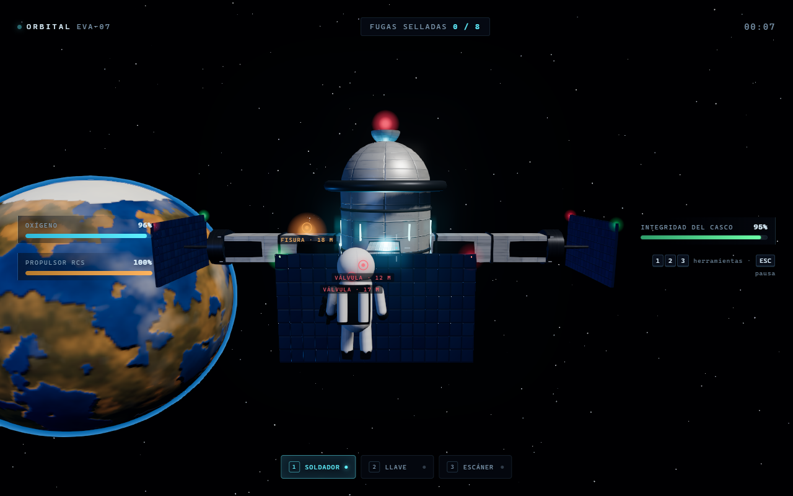
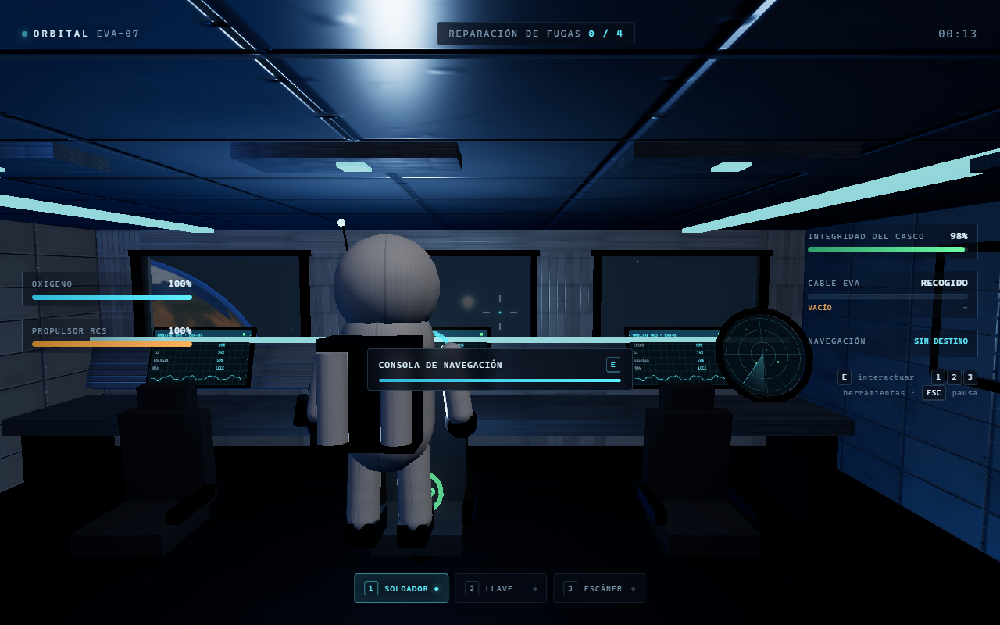
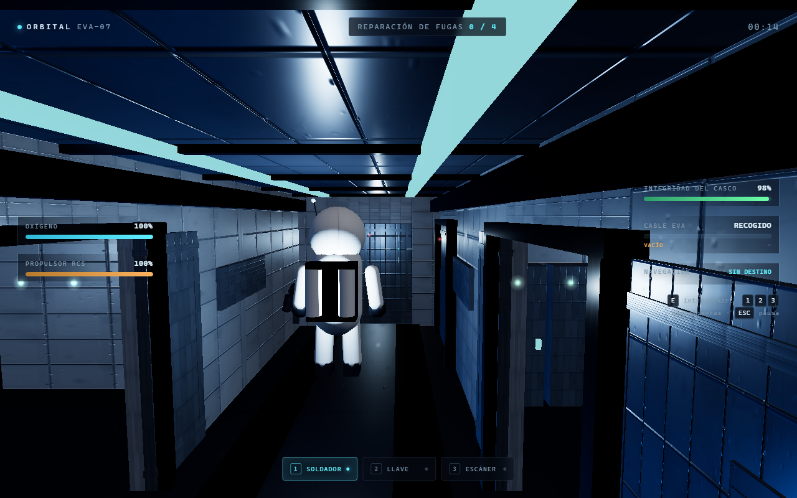

# ORBITAL — EVA-07

Juego 3D en tercera persona de reparación en gravedad cero. Flota alrededor de una
estación espacial, localiza las fugas y séllalas con la herramienta correcta antes
de quedarte sin oxígeno. La estación incluye un **interior habitable transitable**
(pasillo, esclusa, cabina, operaciones, laboratorio y almacén) al que se entra por
una esclusa con secuencia de presurización, **cable de seguridad EVA**, **misiones
modulares** y **consolas interiores que se usan de verdad**.

- **Three.js r170** para el render: materiales PBR procedurales, sombras selectivas
  y post-procesado moderado (bloom + SMAA).
- **GLB optimizados** para el interior: geometría fusionada por material
  (`habitat.glb` ~10 draw calls) y manifiesto de colisiones propio.
- **cannon-es** para la física 6DOF con gravedad `0, 0, 0`.
- **HTML + CSS** para todo el HUD (nada de texto dentro del canvas).
- **Web Audio API** para el audio, 100 % procedural (sin archivos de sonido).
- **Cero build step**: `public/` es el sitio completo, listo para Cloudflare Pages.



---

## 1. Arrancar

```bash
npm install        # sólo para las herramientas de desarrollo y el vendor
npm run dev        # http://localhost:5173
```

No hace falta compilar nada: las librerías ya están copiadas en `public/vendor/`.

```bash
npm run check      # valida la sintaxis de todos los módulos
npm run smoke      # prueba real en Chrome headless (requiere Chrome instalado)
npm run bench -- --label mi-medicion --quality high
```

> El juego usa módulos ES + import map, así que hay que servirlo por HTTP.
> Abrir `index.html` con `file://` no funciona.

### Compartir el proyecto en tiempo real

`npm run dev` escucha en toda la red local e imprime las direcciones que puede
abrir tu compañero:

```text
ORBITAL listo en http://localhost:5173
  Compañeros en la misma red:
    http://192.168.1.33:5173  (Wi-Fi 2)
  Live reload activo: al guardar un archivo se recargan los navegadores.
```

- **Live reload**: cualquier cambio en `public/` recarga al instante todas las
  pestañas conectadas (SSE en `/__dev/events`, inyectado sólo en desarrollo).
- **Misma red**: pasa la URL `http://<tu-ip>:5173` a tu compañero. Si no carga,
  permite Node.js en el Firewall de Windows para redes privadas.
- **Internet**: `npm run share` levanta el servidor y abre un túnel temporal con
  `cloudflared` (o `ngrok` si están instalados) e imprime el enlace público.

```bash
winget install --id Cloudflare.cloudflared   # una sola vez
npm run share                                # URL https://….trycloudflare.com
npm run share -- --no-tunnel                 # sólo LAN + recordatorio
```

Para editar **el código** entre dos personas, lo más simple es que ambos
trabajéis sobre la misma carpeta compartida (o un repositorio Git) y que uno
ejecute `npm run dev`/`npm run share`: el live reload lleva los cambios a los
dos navegadores. `npm run share` sólo sirve `public/` en lectura; no expone
`node_modules/` ni permite escribir archivos.

## 2. Estructura

```text
public/                        # ← esto es lo único que se despliega
├── index.html                 # canvas, HUD y pantallas
├── _headers                   # caché de Cloudflare Pages
├── css/
│   └── styles.css             # HUD, paneles, marcadores y pantallas (~25 KB)
├── js/
│   ├── main.js                # bootstrap + captura de errores WebGL
│   ├── core/
│   │   ├── Game.js            # loop, estados, interacción, misiones y consolas
│   │   ├── Balance.js         # dificultades y todos los consumos/recuperaciones
│   │   └── Missions.js        # definiciones de misión + MissionManager
│   ├── engine/
│   │   ├── Physics.js         # mundo cannon-es (gravedad 0, paso fijo)
│   │   ├── Controls.js        # teclado + ratón (Pointer Lock) + gamepad
│   │   ├── Camera.js          # órbita 3.ª persona con smooth damp y colisión
│   │   ├── Audio.js           # síntesis Web Audio (RCS, soldador, respiración)
│   │   ├── Particles.js       # shader de partículas sobre un solo THREE.Points
│   │   ├── Textures.js        # color + normal + roughness procedurales (canvas)
│   │   ├── Materials.js       # biblioteca PBR compartida (casco, traje, metal…)
│   │   ├── Environment.js     # sol, estrellas, Tierra, atmósfera y env map
│   │   ├── Interior.js        # hábitat GLB, colisiones, esclusa y pantallas
│   │   ├── InteriorInteractions.js # consolas y puestos del interior
│   │   ├── PostFX.js          # EffectComposer + bloom + SMAA + OutputPass
│   │   └── Quality.js         # presets Alta / Rendimiento y persistencia
│   ├── entities/
│   │   ├── Player.js          # astronauta, RCS, O2, casco, impactos
│   │   ├── Station.js         # estación procedural, colisionadores y fugas
│   │   ├── Tool.js            # soldador, llave, escáner + animación en mano
│   │   ├── Tether.js          # cable EVA visual + muelle progresivo
│   │   └── ExteriorTasks.js   # paneles, antena, inspecciones y herramientas
│   └── ui/
│       └── HUD.js             # barras, marcadores 3D→2D, prompts, paneles
├── assets/
│   └── interior/
│       ├── habitat.glb        # módulos fusionados por material (~10 draw calls)
│       ├── door.glb           # panel de compuerta reutilizable (1 draw call)
│       └── colliders.json     # cajas estáticas, módulos y puertas
└── vendor/
    ├── three.module.js        # Three.js r170 minificado (~676 KB)
    ├── cannon-es.js           # cannon-es 0.20 minificado (~122 KB)
    └── addons/                # addons r170: EffectComposer, UnrealBloomPass,
                               # SMAAPass, OutputPass, GLTFLoader y sus shaders
```

`node_modules/`, `scripts/` y `package.json` son sólo para desarrollo.
`scripts/build-interior.mjs` es la herramienta de autoría que genera los GLB del
interior y el manifiesto de colisiones (no se sirve en producción).

## 3. Cómo funciona

```text
                 ┌──────────────────────┐
                 │  Controls (kbd/mouse)│
                 └──────────┬───────────┘
                            │ ejes + delta de ratón
                            ▼
┌───────────────┐   ┌──────────────────────┐   ┌──────────────────┐
│  cannon-es    │──►│      Game loop       │◄──│    Three.js      │
│ gravedad 0    │   │ requestAnimationFrame│   │  escena + render │
└───────────────┘   └──────────┬───────────┘   └──────────────────┘
   esfera jugador              │
   cajas estáticas             ├──► Player: fuerzas RCS, O2, energía
   sin fricción global         ├──► Camera: órbita + colisión + shake
                               ├──► Station: fugas, integridad, O2 port
                               ├──► Repair: raycast central + progreso
                               └──► HUD: barras y marcadores proyectados
```

### Física (gravedad cero)

`Physics.js` crea un `World` con gravedad `(0, 0, 0)`, `SAPBroadphase` y paso fijo
de `1/60` con hasta 3 subpasos. El astronauta es una **esfera** de 80 kg con
`fixedRotation`; la estación son cuerpos estáticos (cajas y un cilindro). No hay
malla de colisión compleja ni otros cuerpos dinámicos: el coste es mínimo.

Los propulsores aplican una fuerza de `masa × aceleración` (17 m/s² normal,
30 m/s² con `Shift`) y se limita la velocidad máxima (13 / 22 m/s) para que el
control siga siendo arcade. El cable EVA mantiene al jugador dentro de 24–32 m de
la esclusa; un empuje de emergencia a 150 m queda sólo como último recurso.

### Cámara

Órbita libre con `yaw`/`pitch`, zoom con la rueda y amortiguación exponencial
independiente del framerate. Un raycast barato contra los módulos evita que la
cámara atraviese el casco. La posición del jugador no arrastra la rotación: en
gravedad cero la cámara se mueve con el ratón, no con el cuerpo.

### Reparación

1. Vuela hasta menos de **5,5 m** de una fuga.
2. Apunta al centro de la pantalla: el rayo central intersecta una esfera
   invisible generosa (1,05 m) alrededor de la fuga.
3. Elige la herramienta correcta:
   - **Soldador** → fisuras del casco (`hull`).
   - **Llave** → válvulas (`valve`).
   - **Escáner** → revela todas las fugas durante 12 s (cooldown 4 s).
4. Mantén el clic izquierdo. La barra de progreso se llena en 2,4–3 s.
   Con la herramienta equivocada el progreso retrocede.

Cada reparación suma **+2 % de integridad** y **+6 % de O2**. Los consumos ya no
son constantes fijas: salen de `Balance.js` según la dificultad elegida. En
**Exploración** el O2 baja `0,16 %/s` (≈10 min de EVA), en **Normal** `0,42 %/s` y
en **Desafío** `0,85 %/s`. El oxígeno sólo se consume **fuera** de una zona
presurizada; dentro del hábitat o en una esclusa con presión se recupera. El casco
sólo baja por **impactos** contra la estación (nunca por tiempo) y se repara en la
consola de ingeniería o en el almacén.

### Interior habitable

La estación exterior no ha cambiado: el interior se añade **debajo**, como un
hábitat conectado por una pasarela de servicio. Seis módulos transitables con el
mismo cuerpo esférico, la misma cámara y la misma misión:

| Módulo | Extensión (x · z) | Contenido |
| --- | --- | --- |
| Esclusa | −1,8…1,8 · 2,4…5,6 | Escotilla exterior, banco, paneles, collar de peligro |
| Pasillo | −1,5…1,5 · −8…2,4 | Guías, costillas, conductos y puertas a los laterales |
| Cabina | −4,5…4,5 · −15…−8 | 3 asientos, consola, pantallas, radar y ventanas panorámicas |
| Operaciones | 1,5…8,5 · −4,5…1,5 | Mesa holográfica, consolas perimetrales, taquillas |
| Laboratorio | −8,5…−1,5 · −4,5…1,5 | Bancos, probetas, equipos y estanterías de muestras |
| Almacén | 1,5…7,5 · −8…−4,5 | Estanterías, cajas, botellas de gas y panel de herramientas |



*Cabina: asientos, consola con pantallas animadas, radar y ventanas panorámicas.*



*Pasillo: rieles de luz, costillas y puertas automáticas a los módulos laterales.*

**Assets.** `scripts/build-interior.mjs` genera con `GLTFExporter`:

- `habitat.glb` — 359,4 KB, **5 944 triángulos**, **10 draw calls** (geometría
  fusionada por material).
- `door.glb` — 4,6 KB, **1 draw call** por panel (se instancia 12 veces).
- `colliders.json` — 108 cajas estáticas + 6 definiciones de puerta.

Los materiales del GLB (`int_hull`, `int_panel`, `int_floor`, `int_trim`,
`int_fabric`, `int_glass`, `int_accent`, `int_amber`, `int_screen`, `int_radar`,
`int_door`) se sustituyen en runtime por `MeshStandardMaterial` con las texturas
procedurales de `MaterialLibrary`; las pantallas y el radar usan `CanvasTexture`
redibujadas a 10 Hz.

**Esclusa (secuencia explícita con `E`).** El HUD muestra `E — ENTRAR A LA NAVE`
cuando estás junto a la compuerta exterior. Al pulsar `E` se abre la compuerta
exterior; caminas dentro, se cierra y la esclusa presuriza durante 1,4 s antes de
abrir la interior. La salida es simétrica: `E — SALIR AL EXTERIOR`, cierre de la
compuerta interior, despresurización de 1,4 s y apertura de la exterior. El jugador
**nunca se teletransporta**: la secuencia sólo anima paneles y habilita o
deshabilita su colisionador. Cada compuerta sólo colisiona cuando está casi
cerrada, así que no hay paredes invisibles al abrir. Si el jugador se aleja con una
compuerta abierta, la secuencia se cancela y la esclusa vuelve a su estado de
reposo sin presurizar ni despresurizar de más. Los avisos salen como toasts del HUD.

**Puertas interiores.** Se abren por proximidad (< 2,8 m) y se cierran al
alejarse (> 3,8 m), deslizando dos paneles. Mientras están abiertas su caja de
colisión tiene `collisionResponse = false`.

### Cable EVA

Al salir al exterior se despliega automáticamente un cable de seguridad anclado a
la esclusa (`Tether.js`). El cable es una `THREE.Line` de 32 puntos que se curva
con la tensión; la física aplica un muelle **progresivo** sobre el cuerpo de
cannon-es a partir del 90 % de la longitud máxima (24–32 m según dificultad), con
amortiguación para que no dé tirones. El HUD muestra estado, distancia, tensión y
un aviso `CABLE AL LÍMITE`. Al volver a una zona presurizada se recoge solo.

### Dificultades y recursos

La pantalla de inicio y la pausa permiten cambiar de dificultad en caliente. Todos
los valores viven en `public/js/core/Balance.js` y se guardan en `localStorage`
(`orbital.difficulty.v1`).

| Ajuste | Exploración | Normal | Desafío |
| --- | --- | --- | --- |
| O2 en EVA | 0,16 %/s | 0,42 %/s | 0,85 %/s |
| O2 al propulsar | +0,05 %/s | +0,16 %/s | +0,30 %/s |
| RCS al propulsar | 1,2 %/s | 2,4 %/s | 4,0 %/s |
| Recuperación de O2 | 14 %/s | 10 %/s | 6 %/s |
| Umbral de impacto | 3,4 m/s | 3,0 m/s | 2,6 m/s |
| Daño de impacto | ×0,8 | ×1,0 | ×1,35 |
| Cable | 32 m | 28 m | 24 m |

Reglas de recursos: el O2 **sólo** se consume en EVA; el RCS **sólo** al propulsar
y se recarga en zona presurizada; el casco **sólo** baja por impactos y se repara
en las consolas. No hay desgaste pasivo por tiempo.

### Misiones modulares

`Missions.js` define las misiones como datos: id, categoría, ámbito, dificultad,
descripción, recompensa y objetivos con su tipo de evento. `MissionManager`
mantiene **una sola misión activa** y avanza sus objetivos con `notify(type)`, así
que añadir una misión nueva es añadir un objeto a `MISSIONS`. El progreso no se
pierde al cruzar la esclusa, cambiar de sala o abrir una consola.

Incluye diez misiones: fugas del casco, paneles solares, antena, sustitución de
componentes, inspección de módulos, recuperación de herramientas, circuitos de
ingeniería, filtros de O2, análisis de laboratorio y reconocimiento de navegación.
Las misiones exteriores usan objetos reales (`ExteriorTasks.js`): anillos 3D sobre
los paneles, la antena o las herramientas perdidas, con progreso al mantener `E` y
la herramienta correcta. Las interiores se completan desde sus consolas.

### Consolas interiores

`InteriorInteractions.js` coloca seis puntos interactivos reales: navegación,
asiento del piloto, ingeniería, laboratorio, almacén y soporte vital. Al pulsar `E`
cerca de uno se abre un panel HTML con botones que modifican el estado de la
partida: activar misiones, marcar destinos, restablecer circuitos (que devuelven
potencia a las luces), sustituir filtros (mejoran la recuperación de O2), analizar
muestras, recoger kits/filtros y reparar el casco. Mientras el panel está abierto
se libera el puntero y se pausa el movimiento, pero las tareas en curso siguen
avanzando; si te alejas de la consola, la tarea se cancela.

**Luces y capas.** El interior vive en la **capa 1** y el exterior en la 0; la
cámara tiene ambas activas. Cuatro `PointLight` y tiras emisivas (base oscura +
`emissive`, para que la luz puntual no las queme) iluminan el hábitat. Como
Three.js filtra luces por capas de cámara (no por objeto), en el preset sin
sombras el sol, el rim y el relleno se atenúan al 22 % al entrar para que manden
las luces interiores. La cámara baja su punto de mira de 0,85 m a 0,42 m dentro y
limita su altura al hueco real (techo − 0,45 m) para no pegarse a las luminarias.

**Rendimiento.** El interior suma unos **6 000 triángulos** y **24 draw calls**
(la vista de rendimiento del smoke pasa de 113 / 11 748 a 137 / 18 512). Los
colisionadores son cajas estáticas en `SAPBroadphase`: no hay mallas de colisión
ni cuerpos dinámicos nuevos.

### HUD y marcadores

Todo el HUD es HTML/CSS con `position: absolute`. Los marcadores de fuga se
proyectan una vez por frame con `Vector3.project(camera)` y se mueven con
`translate3d` (sin reflow). Las barras usan `transform: scaleX()`.

Además de O2, RCS e integridad, el HUD muestra el **estado de la esclusa y su
presión**, el **cable EVA** (estado, distancia y tensión), el **objetivo de la
misión activa**, el **destino de navegación** y una columna de **avisos** (O2 bajo,
casco dañado, RCS bajo, cable al límite, esclusa despresurizada). Los paneles de
consola son overlays HTML con botones reales.

### Audio

No hay `.mp3`: se sintetiza ruido filtrado y osciladores. El propulsor es ruido
paso-bajo con ganancia según empuje; el soldador es ruido de banda + sierra; la
respiración es ruido modulado por un LFO y se acelera cuando baja el O2.

### Partículas

Tres sistemas (`thruster`, `sparks`, `leak`) con pooling sobre un único
`THREE.Points` cada uno: cero allocations por frame y una draw call por sistema.
El shader calcula tamaño por partícula con atenuación por distancia y desvanece
el sprite según la vida restante.

### Gráficos y presets de calidad

Todo el apartado visual es procedural: **no hay imágenes ni modelos descargados**.

- **Materiales PBR** (`MeshStandardMaterial`) con `map` sRGB, `normalMap` y
  `roughnessMap` generados en canvas. Juego de texturas para casco, metal oscuro,
  traje y paneles solares.
- **Tierra procedural**: color, relieve (normal map), nubes en una segunda esfera
  y atmósfera Fresnel 3D (no un billboard).
- **Estrellas 3D** con parpadeo en shader y **luces de navegación** rojo/verde con
  glow aditivo y baliza estroboscópica en la antena.
- **Iluminación**: direccional solar con sombras PCF suaves, relleno azul, hemisférica,
  ambiental y un point light de estación. El `environment map` sale de un
  `PMREMGenerator` sobre un canvas equirectangular, para reflejos en metal y visor.
- **Postprocesado** (`EffectComposer`): `RenderPass` → `UnrealBloomPass` moderado
  (0,32 / 0,45 / 0,82) → `OutputPass` → `SMAAPass` (a pantalla). `OutputPass` es
  quien aplica ACES y sRGB: al renderizar al render target del composer, Three.js
  no aplica tone mapping en los materiales, así que no hay doble corrección.

Los dos presets se eligen en la pantalla de inicio o en la pausa y se guardan en
`localStorage` (`orbital.quality.v1`):

| Ajuste | Alta | Rendimiento |
| --- | --- | --- |
| `devicePixelRatio` | 1,25 | 1 |
| Sombras | 1024 px | off |
| Bloom | sí | no |
| AA | SMAA | ninguno |
| Anisotropía | 8 | 2 |
| Estrellas | 2400 | 1200 |
| Point light de estación | sí | no |

El preset se autodetecta en el primer arranque (pantallas pequeñas, táctil o
pocos núcleos → Rendimiento). Cambiar de preset reconstruye sólo el composer:
no se recarga la escena ni se pierde la partida.

## 4. Controles

| Entrada | Acción |
| --- | --- |
| `W` `A` `S` `D` | Propulsores RCS relativos a la cámara |
| `Espacio` / `Ctrl` | Subir / bajar |
| `Shift` | Empuje máximo |
| Ratón | Orbitar la cámara |
| Rueda | Acercar / alejar |
| `1` `2` `3` | Soldador · Llave · Escáner |
| Clic izquierdo | Reparar (mantener) / escanear |
| `E` | Entrar/salir de la esclusa · usar consolas · completar tareas EVA |
| `Esc` | Liberar el cursor y pausar · cerrar un panel |
| Gamepad | Stick izq. mover · stick der. cámara · RT/LT subir/bajar · A reparar · X interactuar |

## 5. Rendimiento medido

Benchmark reproducible (`npm run bench`) en Chrome headless, 1280×800, cámara
fija a 18 m de la estación, 5 s de `requestAnimationFrame`. GPU de referencia:
**Intel UHD Graphics 620** (integrada).

| Métrica | Antes | Alta | Rendimiento |
| --- | --- | --- | --- |
| FPS medio | 60,1 | 49,7 | **58,2** |
| Frame time | 16,62 ms | 20,10 ms | 17,17 ms |
| Draw calls | 104 | 194 | 137 |
| Triángulos | 7 414 | 26 875 | 18 488 |
| Texturas | 3 | 39 | 21 |

Los JSON y las capturas están en `docs/benchmarks/` (`baseline`, `after-high`,
`after-performance`, `after-interior-high`, `after-interior-performance`). La
columna **Antes** es el baseline original, sin interior; **Alta** y
**Rendimiento** ya incluyen el hábitat completo.

Lectura de los datos:

- El **preset de rendimiento se queda en ~58 FPS** (±2 FPS entre ejecuciones) con
  el exterior PBR y el interior habitable. El hábitat cuesta unas 24 draw calls y
  ~6 700 triángulos, pero el cuello de botella sigue siendo el relleno de
  pantalla, no la geometría.
- El **preset alto ronda los 50 FPS** en esta iGPU: el coste está en bloom + SMAA
  + IBL y en la pasada de sombras (que también dibuja el interior). En una GPU
  dedicada va sobrado; en integradas antiguas conviene Rendimiento.
- Las draw calls del preset alto suben a 194 por la pasada de sombras (~60) y el
  postprocesado; el número de triángulos sigue siendo bajo para un juego 3D.
- Los resultados usan la misma vista y el mismo equipo; el baseline original se
  midió antes de tocar código y las demás filas incluyen el interior.

Optimizaciones aplicadas tras la primera medición:

- Tierra y nubes a 40×28 segmentos y materiales Phong/Lambert en vez de Standard
  con IBL (−7 500 triángulos, +7 FPS).
- Bloom a media resolución y SMAA en lugar de MSAA 2× sobre HalfFloat
  (MSAA costaba ~10 FPS en esta GPU).
- Sombras sólo en las piezas que definen la silueta.
- `renderer.info.autoReset = false` para poder medir todas las pasadas del frame.

Librerías: ~1 MB sin comprimir (Three.js r170 + addons de postprocesado y
`GLTFLoader` + cannon-es), más 389 KB de assets del interior. Con gzip/brotli de
Pages queda en ~280 KB.

## 6. Despliegue en Cloudflare Pages

La carpeta `public/` es el sitio completo. Tres opciones:

**A. Wrangler (rápido)**

```bash
npx wrangler pages deploy public --project-name orbital-eva
```

**B. Panel de Cloudflare (drag & drop)**

Pages → *Create a project* → *Direct upload* → arrastra la carpeta `public/`.

**C. Git**

Conecta el repositorio y configura:

- **Build command:** *(vacío)*
- **Build output directory:** `public`

`public/_headers` ya define caché larga para `vendor/` y corta para `js/` y `css/`.

## 7. Ajustes rápidos

| Qué | Dónde |
| --- | --- |
| Fuerza de propulsores | `Player.js` → `acceleration` (17 / 30) |
| Velocidad máxima | `Player.js` → `maxSpeed` (13 / 22) |
| Consumo de O2 / RCS | `core/Balance.js` → `o2Drain`, `rcsDrain`… |
| Recuperación y daños | `core/Balance.js` → `o2Regen`, `hullImpactScale`… |
| Dificultad inicial | `core/Balance.js` → `DEFAULT_DIFFICULTY` |
| Cable EVA | `core/Balance.js` → `tetherLength/Stiffness/Damping` |
| Misiones | `core/Missions.js` → `MISSIONS` |
| Tareas exteriores | `entities/ExteriorTasks.js` → `TASK_DEFINITIONS` |
| Consolas interiores | `engine/InteriorInteractions.js` → `POINTS` |
| Daño por fuga | `Game.js` → `completeRepair` / `updateMission` |
| Tiempo de reparación | `Tool.js` → `repairTime` |
| Nº de fugas | `Station.js` → `totalBreaches` y `BREACH_POINTS` |
| Fugas simultáneas | `Station.js` → `MAX_ACTIVE` |
| Cámara | `Camera.js` → distancia, sensibilidad, `pitch` |
| Presets de calidad | `Quality.js` → `QUALITY_PRESETS` |
| Bloom | `Quality.js` → `bloomStrength`, `bloomRadius`, `bloomThreshold` |
| Intensidad del sol | `Environment.js` → `sunLight` |
| Reflejos PBR | `Environment.js` → `scene.environmentIntensity` |
| Luces del interior | `Interior.js` → `_buildLights()` |
| Emisión de tiras | `Interior.js` → `int_accent` / `int_amber` |
| Tiempos de esclusa | `Interior.js` → `airlock.timer` (1,4 s) |
| Distancia de puertas | `Interior.js` → `_updateDoors()` (2,8 / 3,8 m) |

## 8. Cambiar el arte procedural por modelos GLB

El exterior sigue siendo 100 % procedural, pero el **interior ya usa GLB**
(`public/assets/interior/`). Para llevar el mismo pipeline al astronauta o a la
estación:

1. Copia `astronaut.glb`, `station.glb` y `tools.glb` a `public/assets/models/`.
2. El import map ya resuelve `three/addons/`; `GLTFLoader.js` y
   `BufferGeometryUtils.js` están vendorizados en `public/vendor/addons/`.
3. Sustituye `Player._buildMesh()` / el contenido de `Station._buildStation()`
   por el `gltf.scene`. **Mantén los colisionadores actuales**: ya están
   definidos con las dimensiones de la geometría procedural.
4. Para animaciones, usa `AnimationMixer` y reproduce `Idle` / `Thrust` / `Repair`
   desde `Player.sync()`.

El interior es el ejemplo completo: `scripts/build-interior.mjs` fusiona la
geometría por material con `mergeGeometries`, exporta con `GLTFExporter` y
escribe `colliders.json` para que malla y física compartan medidas. Para
regenerarlo:

```bash
npm run build:interior   # reescribe habitat.glb, door.glb y colliders.json
```

## 9. Siguiente iteración (roadmap)

- [x] Más tipos de avería (eléctrica, batería, antena) y tareas exteriores reales.
- [x] Reparaciones dentro del hábitat (circuitos, filtros y muestras).
- [x] Misiones modulares con progreso, recompensa y dificultad.
- [x] Cable EVA, esclusa explícita y dificultades de recursos.
- [ ] Animaciones (`AnimationMixer`) en compuertas y brazos de la consola.
- [ ] Tabla de mejores tiempos en `localStorage`.
- [ ] Controles táctiles y detección de mando conectado en el HUD.
- [ ] Física en Web Worker si se añaden muchos escombros dinámicos.
- [ ] Modo "tormenta de micrometeoritos" con fugas múltiples.

## 10. Decisiones frente al plan inicial

- **Tailwind → CSS propio.** El HUD son ~25 KB de CSS; cargar Tailwind por CDN
  añadía peso y una dependencia de red para algo que se escribe una vez.
- **Yuka → matemáticas propias.** Para orbitar una cámara y orientar un cuerpo
  no hace falta un framework de steering: ~200 líneas y una dependencia menos.
- **GLB → sólo donde aporta.** El exterior sigue siendo geometría procedural
  (0 descargas, silueta controlada). El interior se modela con un script de
  autoría y se exporta a GLB porque son ~6 000 triángulos y 100+ piezas: fusionar
  por material deja 10 draw calls y permite editar el layout en código.
- **Audio procedural.** Sin archivos: menos peso, sin problemas de licencias y
  el sonido reacciona al estado (O2, empuje, reparación).
- **Librerías vendorizadas.** Sin CDN en runtime: funciona offline, sin CORS y
  con caché inmutable en Pages.
